<h1 align="center">Claude Drawing · Claude 绘图</h1>

<p align="center">
  <b>Claude paints with code — no image model.</b><br>
  不用生图模型，Claude 用代码一笔一笔作画。
</p>

<p align="center">
  <a href="#styles--画风">83 styles · 画风</a> &nbsp;·&nbsp;
  <a href="#install--安装">Install · 安装</a> &nbsp;·&nbsp;
  <a href="#quick-start--快速上手">Quick start · 快速上手</a> &nbsp;·&nbsp;
  <a href="docs/GIFS.md">Draw-on GIFs · 作画动图</a> &nbsp;·&nbsp;
  <a href="SKILL.md">SKILL.md</a>
</p>

<p align="center">
  <a href="#styles--画风">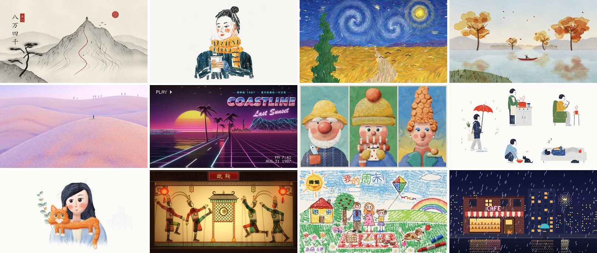</a>
</p>

**What it is · 这是什么** — A [Claude Code](https://claude.com/claude-code) skill plus a small painting library: eighty-three styles, from ink wash and impasto oil to stained glass, a ray-traced ball pit and a VHS tape, all plain Python with **numpy + Pillow** on a CPU.<br>
一个 Claude Code skill，加上一个只用 numpy + Pillow 的绘图库：八十三种画风，从水墨、油画到彩色玻璃花窗、光线追踪的小球海和 VHS 录像带。

**Why code · 为什么用代码** — Composition is directed, not sampled; the same seed gives the same picture; it runs offline with no GPU, key or quota; and every stage can be saved, so you can watch the picture being made.<br>
构图、留白、点睛色都精确可控；同一个随机种子画出同一幅画；离线只用 CPU；每一步都能存下来，做成「一步步画出来」的动画。

**How Claude paints · 怎么画** — It plans the composition, writes a short scene script, then renders, looks and fixes against a per-style checklist of real failure modes, usually over 2–4 rounds. The whole playbook is in [SKILL.md](SKILL.md).<br>
先定构图，再写场景脚本，然后渲染、看图，对照该画风的毛病清单改 2–4 轮。完整做法见 [SKILL.md](SKILL.md)。

<p align="center">
  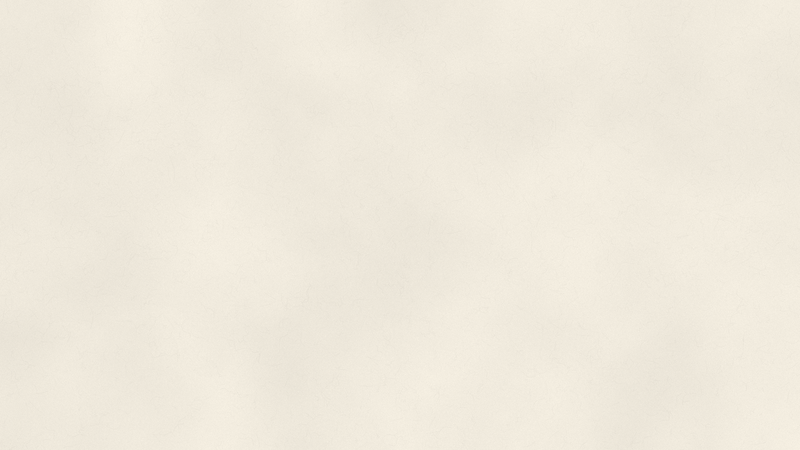<br>
  <sub><b>Ink wash · 水墨</b> — every style is painted stage by stage like this · 每种画风都是这样一步步画出来的 · <a href="docs/GIFS.md">all 91 GIFs · 全部动图</a></sub>
</p>

## Install · 安装

```bash
git clone https://github.com/cloveric/claude-drawing-skill.git ~/.claude/skills/claude-drawing
pip install -r ~/.claude/skills/claude-drawing/requirements.txt   # numpy, Pillow
```

Titles need a CJK font; system ones are found automatically, or set `INKPAINT_FONT=/path/to/font` ([more](docs/USAGE.md)).<br>
题字需要中文字体，系统自带的一般会自动找到，也可以用 `INKPAINT_FONT=字体路径` 指定（[详见](docs/USAGE.md#中文)）。

## Quick start · 快速上手

Ask Claude to *"draw it yourself"*, *"paint this with code"* or *"claude绘图"*, and name a style if you like.<br>
对 Claude 说「claude绘图」「你自己画」「用代码画」，也可以指定画风。

Or run any example yourself · 也可以自己跑范例：

```bash
cd ~/.claude/skills/claude-drawing
python3 examples/moon_river.py out.png --stages stages/   # ink wash + every stage · 水墨，存下每一步
python3 examples/<name>.py out.png                        # one per style · 每种画风都有
```

→ [Every example command and the Python API in a few lines · 全部范例命令与代码示例](docs/USAGE.md)

## Styles · 画风

Eighty-three styles in eight families — click any picture for the full-size image. Notes on every style: [docs/STYLES.md](docs/STYLES.md)<br>
八大类、八十三种画风，点图看大图。每种画风的详细说明：[docs/STYLES.zh.md](docs/STYLES.zh.md)

### Ink & paint · 水墨与颜料

<table>
<tr><td align="center" colspan="2"><a href="examples/bawansiqian.jpg">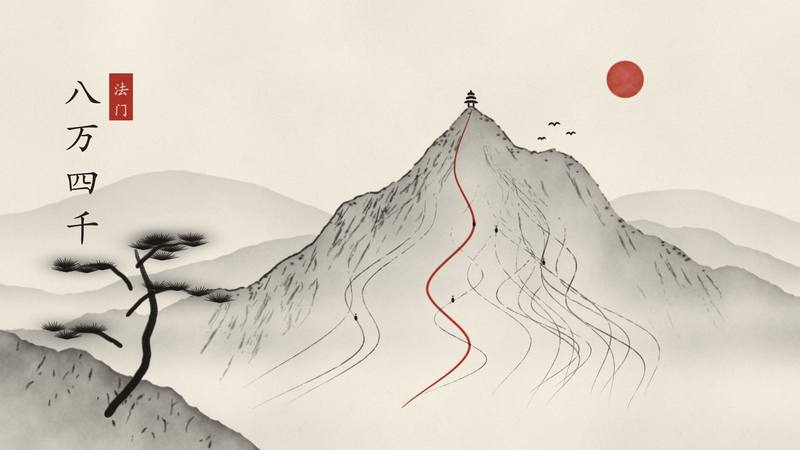</a><br><sub><b>Ink wash</b><br>水墨</sub></td><td align="center" colspan="2"><a href="examples/watercolor_autumn.jpg"></a><br><sub><b>Watercolour</b><br>水彩</sub></td></tr>
<tr><td align="center" colspan="2"><a href="examples/oil_wheatfield.jpg">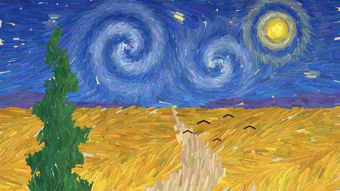</a><br><sub><b>Impasto oil</b><br>油画厚涂</sub></td><td align="center"><a href="examples/gouache_rainy_day.jpg">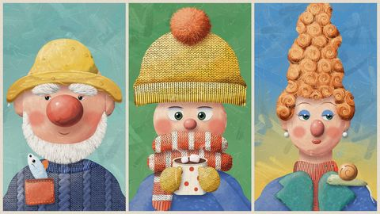</a><br><sub><b>Retro gouache</b><br>复古水粉</sub></td><td align="center"><a href="examples/penwash_neighbours.jpg">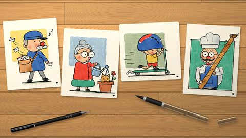</a><br><sub><b>Pen & wash</b><br>钢笔淡彩</sub></td></tr>
<tr><td align="center"><a href="examples/jiangnan_spring_water.jpg">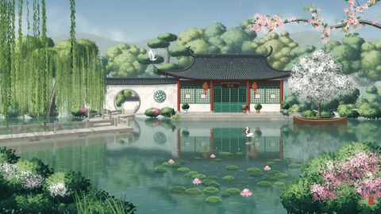</a><br><sub><b>Jiangnan garden</b><br>江南园林</sub></td><td align="center"><a href="examples/drybrush_noodle_counter.jpg"></a><br><sub><b>Dry-brush blocks</b><br>干刷色块</sub></td><td align="center"><a href="examples/oilpastel_warm_cup.jpg">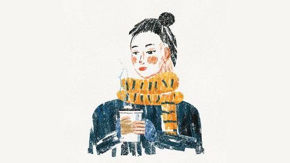</a><br><sub><b>Oil-pastel portrait</b><br>油画棒肖像</sub></td><td align="center"><a href="examples/sunlitgreen_window_seat.jpg">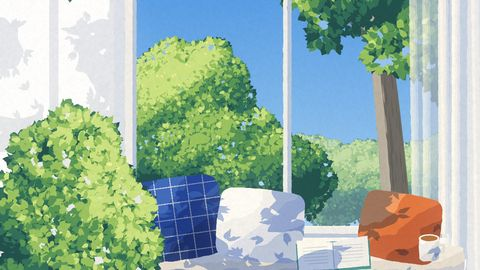</a><br><sub><b>Sunlit greenery</b><br>夏日光绿</sub></td></tr>
</table>

### Pencil, pen & pastel · 铅笔、钢笔与色粉

<table>
<tr><td align="center"><a href="examples/colorpencil_dessert.jpg">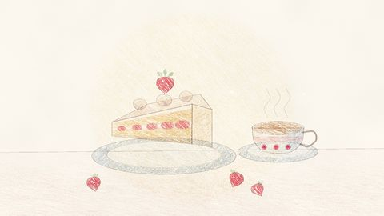</a><br><sub><b>Coloured pencil</b><br>韩国彩铅</sub></td><td align="center"><a href="examples/graphite_bicycle.jpg">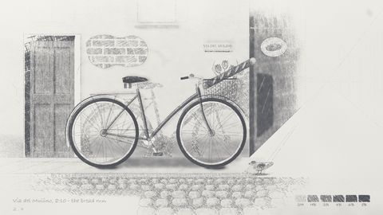</a><br><sub><b>Graphite pencil</b><br>铅笔素描</sub></td><td align="center"><a href="examples/crayon_picnic.jpg">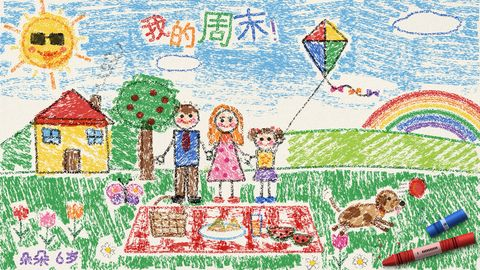</a><br><sub><b>Children's crayon</b><br>儿童蜡笔画</sub></td><td align="center"><a href="examples/ballpoint_board_game.jpg">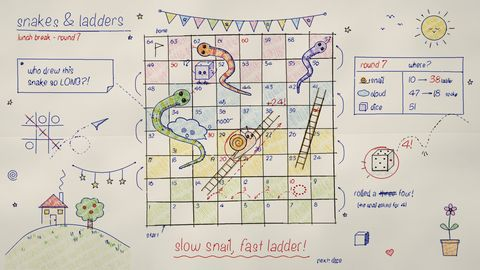</a><br><sub><b>Ballpoint doodle</b><br>圆珠笔涂鸦</sub></td></tr>
<tr><td align="center"><a href="examples/lineart_paper_plane.jpg">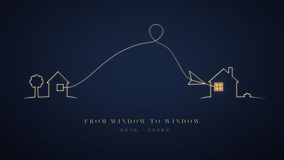</a><br><sub><b>Continuous line art</b><br>单线画</sub></td><td align="center"><a href="examples/sketchbook_reading_hour.jpg"></a><br><sub><b>Sketchbook doodle</b><br>手账线描</sub></td><td align="center"><a href="examples/pastelvignette_marmalade_scarf.jpg"></a><br><sub><b>Pastel vignette</b><br>色粉小像</sub></td><td align="center"><a href="examples/nocturne_lava_sea.jpg">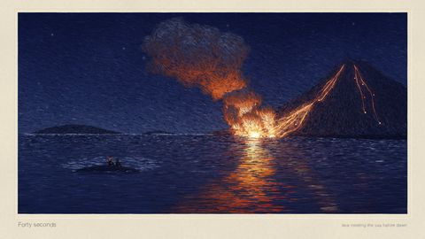</a><br><sub><b>Hatched nocturne</b><br>排线夜景</sub></td></tr>
</table>

### Picture books & illustration · 绘本与插画

<table>
<tr><td align="center"><a href="examples/anime_summer.jpg"></a><br><sub><b>Anime</b><br>日本动漫</sub></td><td align="center"><a href="examples/cartoon_toaster.jpg">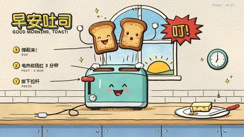</a><br><sub><b>Hand-drawn cartoon</b><br>卡通手绘</sub></td><td align="center"><a href="examples/flatvector_night_camp.jpg"></a><br><sub><b>Flat vector</b><br>扁平矢量</sub></td><td align="center"><a href="examples/storybook_acorn.jpg">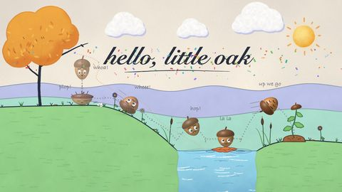</a><br><sub><b>Storybook animation</b><br>绘本角色动画</sub></td></tr>
<tr><td align="center"><a href="examples/bluebook_shared_umbrella.jpg">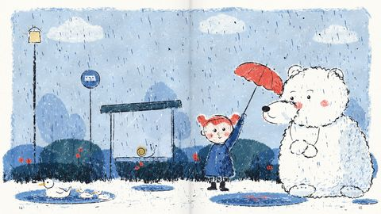</a><br><sub><b>Blue picture book</b><br>蓝调绘本</sub></td><td align="center"><a href="examples/twilight_paper_kite.jpg">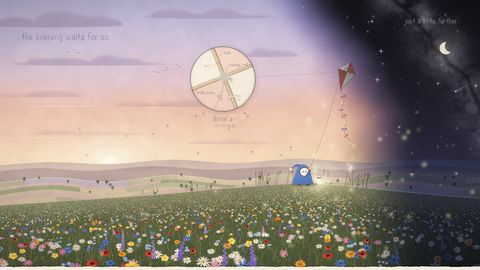</a><br><sub><b>Twilight storybook</b><br>暮色微缩绘本</sub></td><td align="center"><a href="examples/pencilbook_tortoise_crossing.jpg">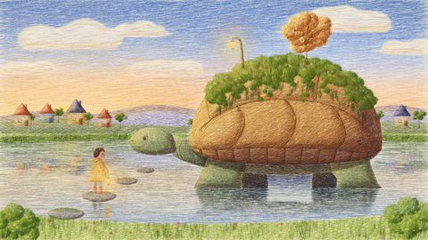</a><br><sub><b>Warm pencil storybook</b><br>暖调彩铅绘本</sub></td><td align="center"><a href="examples/colortown_festival_steps.jpg">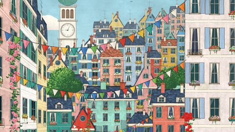</a><br><sub><b>Colour town</b><br>彩色小镇</sub></td></tr>
<tr><td align="center"><a href="examples/poetichalloween_ghost_jar.jpg"></a><br><sub><b>Poetic Halloween</b><br>诗意万圣夜</sub></td><td align="center"><a href="examples/spotillo_rainy_saturday_wide.jpg">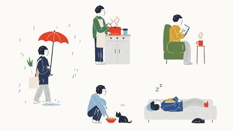</a><br><sub><b>Flat spot illustration</b><br>日系扁平小插画</sub></td><td align="center"><a href="examples/grainbook_snow_walk.jpg"></a><br><sub><b>Grainy picture book</b><br>颗粒童书</sub></td><td align="center"><a href="examples/dreamhills_long_walk.jpg">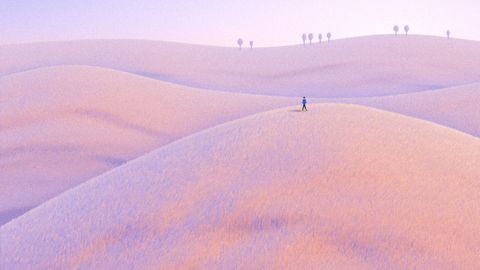</a><br><sub><b>Dreamy hills</b><br>柔光草丘</sub></td></tr>
</table>

### Print & poster · 版画与印刷

<table>
<tr><td align="center"><a href="examples/ukiyoe_fuji.jpg">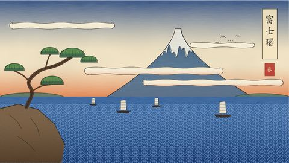</a><br><sub><b>Ukiyo-e woodblock</b><br>浮世绘木版画</sub></td><td align="center"><a href="examples/linocut_snowy_village.jpg">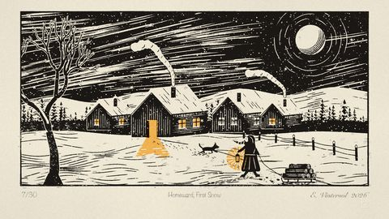</a><br><sub><b>Linocut</b><br>黑白麻胶版画</sub></td><td align="center"><a href="examples/cyanotype_botanicals.jpg">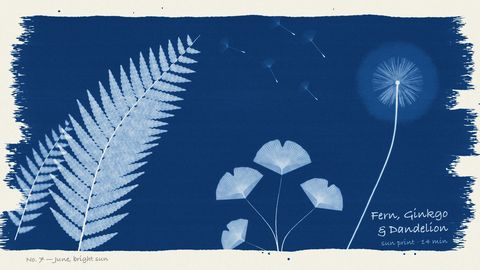</a><br><sub><b>Cyanotype</b><br>蓝晒</sub></td><td align="center"><a href="examples/letterpress_circus.jpg">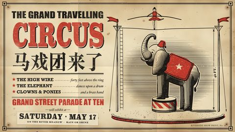</a><br><sub><b>Letterpress poster</b><br>凸版印刷海报</sub></td></tr>
<tr><td align="center"><a href="examples/constructivism_radio.jpg">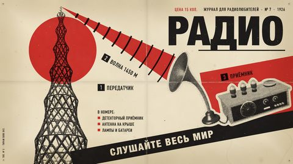</a><br><sub><b>Soviet constructivism</b><br>苏联构成主义</sub></td><td align="center"><a href="examples/bauhaus_form_colour.jpg">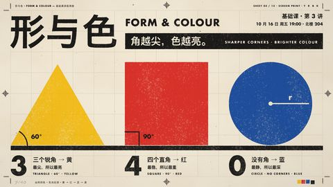</a><br><sub><b>Bauhaus geometric</b><br>包豪斯几何</sub></td><td align="center"><a href="examples/artdeco_express.jpg">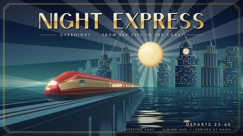</a><br><sub><b>Art Deco</b><br>装饰艺术</sub></td><td align="center"><a href="examples/popart_cat_moods.jpg">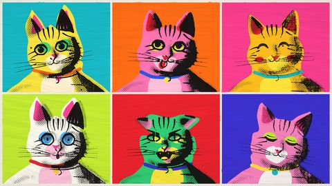</a><br><sub><b>Pop silkscreen</b><br>波普丝网</sub></td></tr>
<tr><td align="center"><a href="examples/comic_rocket.jpg">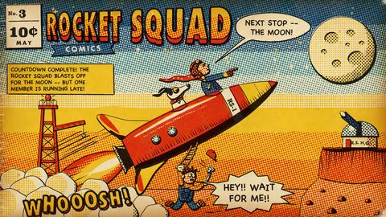</a><br><sub><b>Golden-age comic</b><br>黄金时代漫画</sub></td><td align="center"><a href="examples/editorial_ideas.jpg"></a><br><sub><b>Editorial (risograph)</b><br>编辑风手绘</sub></td><td align="center"><a href="examples/stencil_kite.jpg">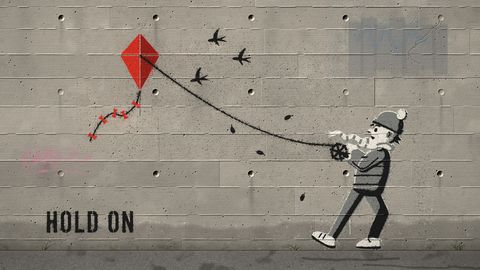</a><br><sub><b>Stencil graffiti</b><br>喷漆模板涂鸦</sub></td><td align="center"><a href="examples/blueprint_lighthouse.jpg">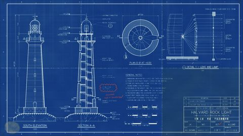</a><br><sub><b>Blueprint</b><br>蓝图工程图</sub></td></tr>
</table>

### Paper, thread & clay · 纸、线与黏土

<table>
<tr><td align="center"><a href="examples/papercut_balloons.jpg">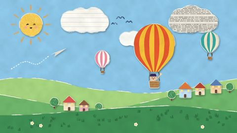</a><br><sub><b>Paper collage</b><br>剪纸拼贴</sub></td><td align="center"><a href="examples/newscollage_curiosity.jpg"></a><br><sub><b>Newspaper collage</b><br>报刊拼贴</sub></td><td align="center"><a href="examples/sticker_market.jpg">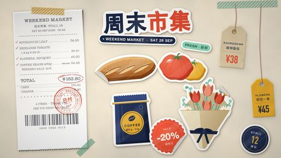</a><br><sub><b>Sticker collage × receipt</b><br>贴纸拼贴 · 小票</sub></td><td align="center"><a href="examples/silhouette_family.jpg">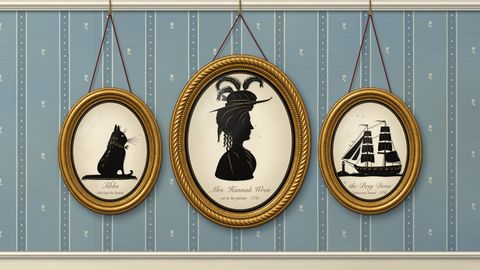</a><br><sub><b>Silhouette</b><br>剪影</sub></td></tr>
<tr><td align="center"><a href="examples/clay_lighthouse.jpg">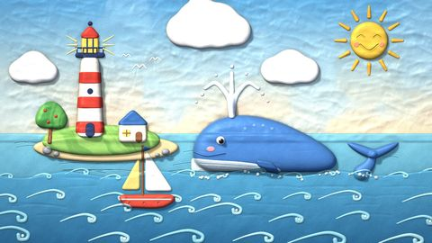</a><br><sub><b>Stop-motion clay</b><br>黏土定格</sub></td><td align="center"><a href="examples/stitch_sampler.jpg">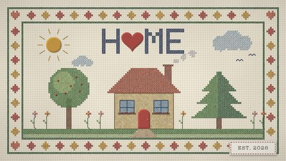</a><br><sub><b>Cross-stitch</b><br>十字绣</sub></td><td align="center"><a href="examples/patch_camping.jpg">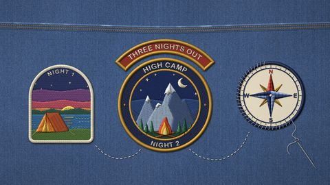</a><br><sub><b>Embroidered patches</b><br>刺绣徽章</sub></td><td align="center"><a href="examples/perler_strawberry_coaster.jpg">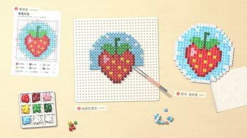</a><br><sub><b>Perler beads</b><br>拼豆</sub></td></tr>
</table>

### Ancient & historic · 古代与历史

<table>
<tr><td align="center" colspan="2"><a href="examples/tomb_harvest.jpg">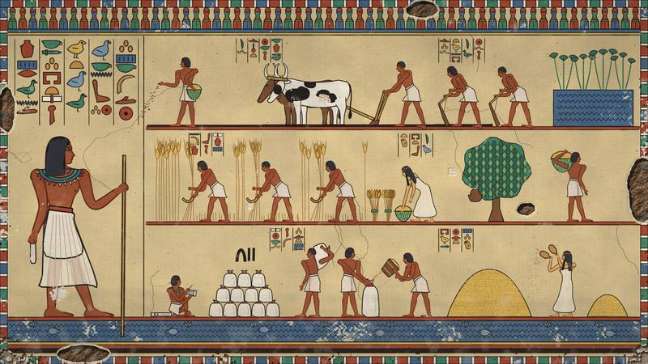</a><br><sub><b>Egyptian tomb painting</b><br>古埃及墓室壁画</sub></td><td align="center" colspan="2"><a href="examples/shadowpuppet_cuju.jpg">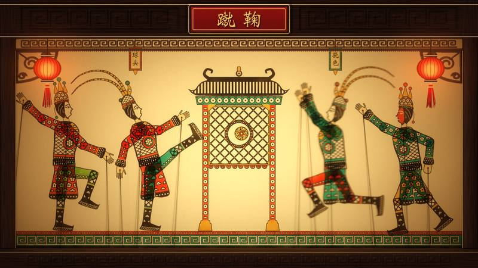</a><br><sub><b>Shadow puppetry</b><br>皮影戏</sub></td></tr>
<tr><td align="center"><a href="examples/cave_hunt.jpg">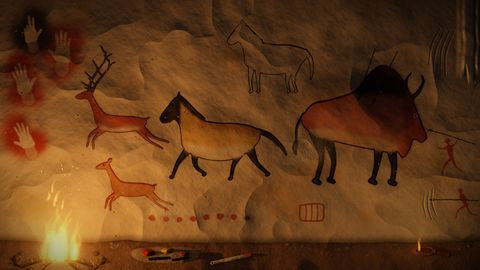</a><br><sub><b>Cave painting</b><br>洞穴壁画</sub></td><td align="center"><a href="examples/petroglyph_migration.jpg">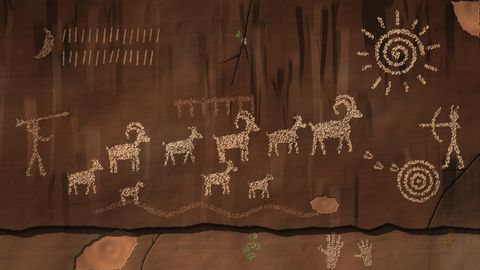</a><br><sub><b>Petroglyph</b><br>岩画</sub></td><td align="center"><a href="examples/blackfigure_games.jpg">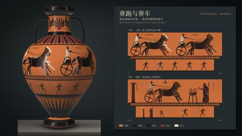</a><br><sub><b>Greek black-figure vase</b><br>古希腊黑绘陶瓶</sub></td><td align="center"><a href="examples/mosaic_harbor.jpg">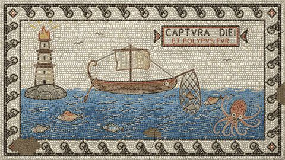</a><br><sub><b>Roman mosaic</b><br>罗马马赛克</sub></td></tr>
<tr><td align="center"><a href="examples/stainedglass_seasons.jpg">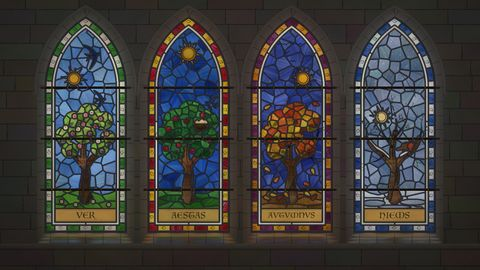</a><br><sub><b>Stained glass</b><br>彩色玻璃花窗</sub></td><td align="center"><a href="examples/illuminated_starchart.jpg">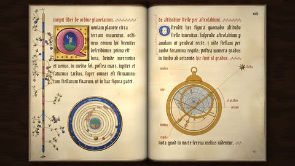</a><br><sub><b>Illuminated manuscript</b><br>泥金手抄本</sub></td><td align="center"><a href="examples/codex_ornithopter.jpg">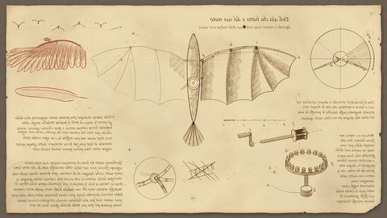</a><br><sub><b>Leonardo codex</b><br>达·芬奇手稿</sub></td><td align="center"><a href="examples/delft_canal.jpg"></a><br><sub><b>Delft tiles</b><br>代尔夫特蓝瓷砖</sub></td></tr>
</table>

### Retro tech & screens · 复古科技与屏幕

<table>
<tr><td align="center"><a href="examples/pixel_rainy_cafe.png"></a><br><sub><b>Pixel art</b><br>像素风</sub></td><td align="center"><a href="examples/macpaint_garden.jpg"></a><br><sub><b>1-bit paint program</b><br>1-bit 早期画图软件</sub></td><td align="center"><a href="examples/crt_weather.jpg"></a><br><sub><b>Green-screen CRT</b><br>绿屏终端</sub></td><td align="center"><a href="examples/lineprinter_launch.jpg"></a><br><sub><b>ASCII art (line printer)</b><br>ASCII 字符画</sub></td></tr>
<tr><td align="center"><a href="examples/lowpoly_canyon.jpg"></a><br><sub><b>Low poly</b><br>低多边形</sub></td><td align="center"><a href="examples/synthwave_coastline.jpg"></a><br><sub><b>Retro synthwave</b><br>复古 Synthwave</sub></td><td align="center"><a href="examples/vhs_birthday.jpg"></a><br><sub><b>VHS home video</b><br>VHS 家庭录像</sub></td><td align="center"><a href="examples/cyberpunk_neon_street.jpg"></a><br><sub><b>Cyberpunk</b><br>赛博朋克</sub></td></tr>
<tr><td align="center"><a href="examples/rubberhose_morning.jpg"></a><br><sub><b>1930s rubber hose</b><br>1930 年代黑白橡皮管动画</sub></td><td align="center"><a href="examples/panel_radio.jpg"></a><br><sub><b>Vintage instrument panel</b><br>复古仪器面板</sub></td><td align="center"><a href="examples/thermal_kitchen.jpg"></a><br><sub><b>Thermal camera</b><br>热成像</sub></td><td align="center"><a href="examples/xray_luggage.jpg"></a><br><sub><b>X-ray</b><br>X 光片</sub></td></tr>
</table>

### 3D, UI & diagrams · 3D、界面与图解

<table>
<tr><td align="center"><a href="examples/soft3d_rise.jpg"></a><br><sub><b>Soft 3D</b><br>柔光 3D</sub></td><td align="center"><a href="examples/isometric_weather_island.jpg"></a><br><sub><b>Isometric 2.5D</b><br>等轴 2.5D</sub></td><td align="center"><a href="examples/aurora_morning.jpg"></a><br><sub><b>Aurora glass</b><br>弥散玻璃</sub></td><td align="center"><a href="examples/morph_water_cycle.jpg"></a><br><sub><b>Shape morph</b><br>形变动画</sub></td></tr>
<tr><td align="center"><a href="examples/pastelui_packing.jpg"></a><br><sub><b>Pastel UI</b><br>粉彩界面</sub></td><td align="center"><a href="examples/obsidianui_reading_notes.jpg"></a><br><sub><b>Obsidian UI</b><br>笔记应用界面</sub></td><td align="center"><a href="examples/canvasboard_moving_plan.jpg"></a><br><sub><b>Canvas board</b><br>白板卡片</sub></td><td align="center"><a href="examples/flexoki_pour_over.jpg"></a><br><sub><b>Flexoki paper</b><br>Flexoki 纸面</sub></td></tr>
<tr><td align="center"><a href="examples/notebook_brewing.jpg"></a><br><sub><b>Lab notebook × stickers</b><br>实验笔记本 · 贴纸</sub></td><td align="center"><a href="examples/grading_math_quiz.jpg"></a><br><sub><b>Exam grading</b><br>阅卷批改</sub></td><td align="center"><a href="examples/overlay_city_map.jpg"></a><br><sub><b>Overlay sheets</b><br>描图纸叠层</sub></td><td align="center"><a href="examples/chalk_lesson.jpg"></a><br><sub><b>Chalkboard</b><br>黑板板书</sub></td></tr>
</table>

## More · 更多

| Page · 页面 | What's in it · 内容 |
|---|---|
| [Styles](docs/STYLES.md) · [画风详解](docs/STYLES.zh.md) | What makes each style read as the real medium, and its module · 每种画风为什么像真的、对应的模块 |
| [Principles](docs/PRINCIPLES.md) · [作画要点](docs/PRINCIPLES.zh.md) | The checklist Claude goes through before handing over a picture · Claude 交图前逐条自查的清单 |
| [Usage · 用法](docs/USAGE.md) | Install notes, fonts, Python snippets, every example command · 安装、字体、代码示例、全部范例命令 |
| [Gallery · 画廊](docs/GALLERY.md) | Every example at full size, with its title (≈ 57 MB) · 全部范例大图与标题 |
| [Draw-on GIFs · 作画动图](docs/GIFS.md) | 91 GIFs of pictures being painted (≈ 104 MB) · 91 段作画过程动图 |
| [SKILL.md](SKILL.md) | The full skill: workflow, API reference, failure-mode lists, animation · 完整 skill：流程、接口速查、毛病清单、做成动画 |

## Roadmap · 计划

- Per-stroke layer export, for stroke-by-stroke animation in Motion Canvas or Remotion.
- 按笔画分层导出，方便在 Motion Canvas / Remotion 里做逐笔动画。

---

MIT License · Made by Claude (Opus 5.5) with [@cloveric](https://github.com/cloveric)

### 友链
本开源项目已链接并认可 LINUX DO 社区。https://linux.do/
